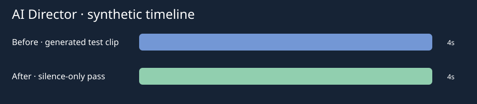

# AI Director

Turn a talking-head clip into a **reviewable cut list**. Start with deterministic FFmpeg silence detection, then inspect the kept intervals before importing an EDL or FCPXML into an editor. Optional transcription and semantic cut suggestions are separate from the offline path.

[Try the synthetic input](examples/synthetic-input.mp4) · [Inspect the keep list](examples/sample-keep-list.json) · [Inspect the EDL](examples/sample-davinci.edl) · [Architecture](docs/architecture.md)

> **Portfolio scope:** The public fixture demonstrates the offline export path. It does not prove speech accuracy, model cut quality, NLE import, or a final rendered video.

## Reproduce the offline example

Requires Python 3.10+, FFmpeg and FFprobe. Install the Python dependencies once; the sample run itself requires no model, API key or editor session.

```bash
python3 -m venv .venv
. .venv/bin/activate
python -m pip install -r requirements.txt
python ai_director.py examples/synthetic-input.mp4 \
  --silence-only --no-video --no-launch-pr --output-dir ./output/portfolio-demo
```

| Inspect after running | What it shows |
| --- | --- |
| `synthetic-input_keep_list.json` | One kept interval from 0 to 4.017 s; the generated tone contains no detected silence. |
| `synthetic-input_davinci.edl` | One source/record edit event; the committed EDL is a readable comparison. |
| `synthetic-input_premiere.fcpxml` | A timeline and a file URI pointing to your local sample; regenerate after moving the source. |

No SRT is expected in `--silence-only` mode because there is no transcript. The sample flags also suppress final MP4 rendering and the optional Premiere bridge.



## How it works

```text
Video → FFmpeg audio extraction → silence detection → keep list → EDL / FCPXML
                                           ↳ optional transcript and semantic cuts → SRT
```

- Deterministic cuts and timestamps can be inspected without a provider.
- On the optional path, Whisper-compatible transcription and DeepSeek-compatible semantic suggestions can send audio or transcript text to the configured services. Use media you are allowed to send, keep credentials out of Git, and review proposals before using them.
- The repository contains synthetic media only. No claims about a client deployment, full NLE integration, or automatic publishing.

## Verification

```bash
PYTHONPATH=. python3 -m unittest discover -s tests -p 'test_*.py'
python3 -m compileall -q ai_director.py modules pr_agent
```

The tests cover kept-interval calculations, subtitle times after cuts, and
the structure of EDL/FCPXML exports. They do not validate a rendered video or
editing decisions from a model.

## Status

Public prototype. The deterministic timeline helpers are testable locally;
external provider, media and Premiere integrations remain environment-dependent.

## License

MIT. See [LICENSE](LICENSE).

See [architecture](docs/architecture.md), [resume bullets](docs/resume-bullets.md)
and [interview notes](docs/interview-notes.md). No provider-backed transcript
or semantic edit quality is claimed by the synthetic sample.
